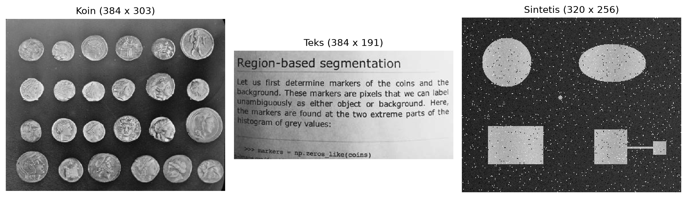
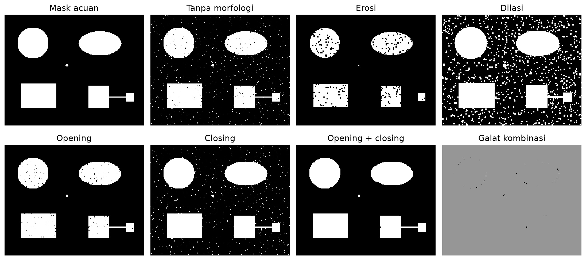
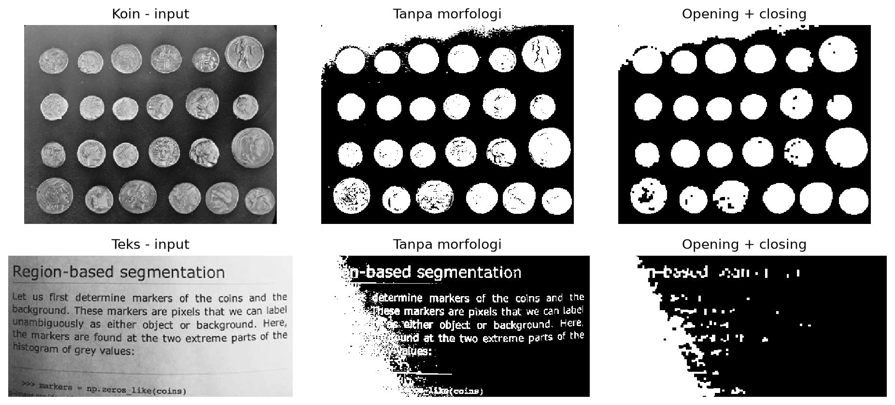
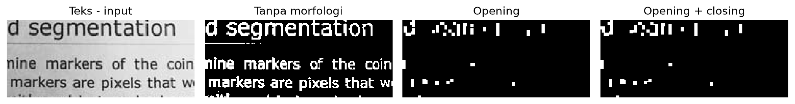
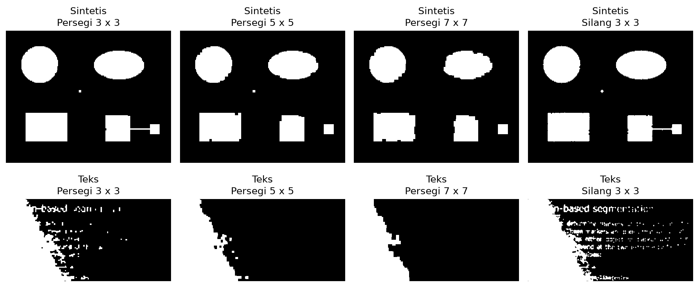

# PCD_Assignment03: Analisis Segmentasi K-means dan Operasi Morfologi

[](https://colab.research.google.com/github/hanafishiddiq/PCD_Assignment03/blob/main/PCD_Assignment03.ipynb)

Laporan penugasan mata kuliah Pengolahan Citra Digital. Notebook mengimplementasikan satu metode segmentasi dan empat operasi morfologi dari awal, kemudian membandingkan pengaruhnya pada tiga citra.

## Citra uji dan metodologi

Eksperimen membandingkan segmentasi K-means sebelum dan sesudah erosi, dilasi, opening, serta closing. Seluruh algoritma, flood fill, dan metrik ditulis dari awal. NumPy digunakan untuk array dan operasi dasar, Pillow untuk baca/simpan gambar, Matplotlib untuk visualisasi, dan pandas untuk tabel.



Tiga citra uji pada ukuran asli masing-masing.

Koin (384 x 303 piksel) dipilih karena relief dan variasi pencahayaan menyulitkan pemisahan objek dari latar. Halaman teks (384 x 191 piksel) menguji pengaruh morfologi pada goresan huruf yang tipis. Kedua gambar berasal dari koleksi contoh scikit-image, tanpa resize atau penambahan derau.

Citra sintetis (320 x 256 piksel) memiliki mask acuan dari bentuk geometris, termasuk objek kecil dan penghubung selebar tiga piksel. Intensitas diberi derau Gaussian dengan sigma 7 dan impuls dengan probabilitas total 2.5%, menggunakan seed 31. Mask acuan dibentuk sebelum derau dan tidak berasal dari hasil segmentasi.

### Implementasi dan parameter

K-means memakai intensitas grayscale dengan k=2. Centroid awal adalah intensitas minimum dan maksimum. Setiap iterasi menetapkan cluster berdasarkan jarak kuadrat terdekat lalu memperbarui centroid dengan rata-rata anggotanya. Batasnya 100 iterasi atau perubahan centroid <= 0.001. Foreground adalah cluster terang untuk koin/sintetis dan cluster gelap untuk teks. Ketiga input konvergen dalam 7, 8, dan 2 iterasi, sesuai urutan citra tersebut.

Erosi mengambil irisan posisi aktif structuring element, sedangkan dilasi mengambil gabungannya. Opening adalah erosi lalu dilasi; closing adalah dilasi lalu erosi. Percobaan utama menggunakan persegi 3 x 3, ditetapkan sebelum melihat skor. Piksel di luar citra dianggap background; closing mempertahankan margin sementara sampai komposisi selesai.

K-means hanya dijalankan sekali per input. Semua perlakuan menerima mask awal yang sama. Urutan opening lalu closing juga diuji untuk menghapus bintik foreground kemudian menutup lubang kecil.

## Analisis visual dan evaluasi sintetis



Mask acuan, enam perlakuan, dan galat kombinasi. Pada peta galat: putih = FP, hitam = FN, abu-abu = benar.

IoU dan Dice mengukur kesesuaian terhadap mask acuan. Precision menunjukkan proporsi prediksi foreground yang benar, sedangkan recall menunjukkan proporsi foreground acuan yang ditemukan. FP adalah piksel berlebih dan FN adalah piksel objek yang hilang.

| Perlakuan | IoU | Dice | Precision | Recall | FP | FN |
| --- | --- | --- | --- | --- | --- | --- |
| Tanpa morfologi | 0.9353 | 0.9666 | 0.9461 | 0.9880 | 893 | 191 |
| Erosi | 0.8289 | 0.9065 | 1.0000 | 0.8289 | 0 | 2713 |
| Dilasi | 0.6454 | 0.7845 | 0.6454 | 1.0000 | 8715 | 0 |
| Opening | 0.9817 | 0.9908 | 0.9999 | 0.9818 | 2 | 288 |
| Closing | 0.9382 | 0.9681 | 0.9383 | 0.9999 | 1043 | 1 |
| Opening + closing | 0.9955 | 0.9977 | 0.9999 | 0.9956 | 2 | 70 |

Opening lalu closing menaikkan IoU dari 0.9353 menjadi 0.9955 dan Dice dari 0.9666 menjadi 0.9977. FP turun dari 893 menjadi 2, sedangkan FN turun dari 191 menjadi 70 piksel. Bintik di latar hampir seluruhnya hilang dan lubang kecil tertutup.

Erosi sendiri mengurangi luas objek dan menaikkan FN. Dilasi sendiri memperbesar objek sekaligus bintik derau sehingga FP meningkat. Opening menghapus bintik tetapi masih meninggalkan lubang; closing menutup lubang tetapi mempertahankan banyak bintik di luar objek. Kombinasinya paling sesuai pada kasus sintetis ini. Sisa galat masih terlihat pada batas dan detail kecil.

Rumus yang digunakan: IoU = TP / (TP + FP + FN); Dice = 2 * TP / (2 * TP + FP + FN). Skor tersebut hanya berlaku untuk citra sintetis dengan mask acuan yang diketahui.

## Analisis citra nyata



Input, segmentasi awal, dan hasil opening lalu closing pada koin serta teks.

| Citra | Perlakuan | Area % | Komponen | <=9 px | Lubang |
| --- | --- | --- | --- | --- | --- |
| Koin | Tanpa morfologi | 38.78 | 96 | 70 | 533 |
| Koin | Opening + closing | 38.46 | 25 | 0 | 24 |
| Teks | Tanpa morfologi | 36.17 | 230 | 102 | 374 |
| Teks | Opening + closing | 28.63 | 45 | 9 | 4 |

Foreground dihitung dengan konektivitas 8. Lubang dihitung sebagai komponen background berkonektivitas 4 yang tidak menyentuh tepi. Komponen <=9 piksel dicatat sebagai komponen kecil, bukan otomatis derau.

Pada koin, jumlah lubang turun dari 533 menjadi 24 dan komponen kecil turun dari 70 menjadi 0. Relief di dalam koin tampak lebih utuh. Namun latar terang di kiri atas masih ikut menjadi foreground dan beberapa lubang besar bertahan. Morfologi tidak menyelesaikan kesalahan K-means ketika intensitas latar menyerupai objek. Jumlah komponen akhir 25 juga bukan bukti bahwa seluruh objek telah dikenali dengan benar.



Potongan teks yang sama memperlihatkan goresan hilang setelah opening.

Pada teks, area foreground turun dari 36.17% menjadi 28.63%, tetapi keterbacaan justru memburuk karena banyak goresan terhapus. Bayangan kiri sudah termasuk foreground sejak segmentasi awal dan tetap bertahan. Closing dapat menyambungkan bagian yang berdekatan, tetapi tidak mengembalikan huruf yang telah hilang saat opening. Tanpa mask acuan, perubahan luas, komponen, dan lubang hanya menjadi deskripsi struktur, bukan ukuran akurasi.

## Pengaruh structuring element



Opening lalu closing dengan ukuran dan bentuk element yang berbeda.

| Element | IoU sintetis | Dice sintetis | FN |
| --- | --- | --- | --- |
| Persegi 3 x 3 | 0.9955 | 0.9977 | 70 |
| Persegi 5 x 5 | 0.9716 | 0.9856 | 449 |
| Persegi 7 x 7 | 0.9434 | 0.9709 | 896 |
| Silang 3 x 3 | 0.9943 | 0.9971 | 77 |

Pada sintetis, persegi 5 x 5 memutus penghubung tiga piksel dan persegi 7 x 7 juga menghilangkan objek kecil. FN meningkat dari 70 pada persegi 3 x 3 menjadi 449 dan 896. Silang 3 x 3 lebih sedikit mengikis sudut dibanding persegi, tetapi pada input ini menyisakan FP lebih banyak. Pada teks, persegi yang makin besar merusak lebih banyak goresan; silang mempertahankan lebih banyak detail, namun bayangan latar tetap tidak terselesaikan.

## Kesimpulan

Morfologi bermanfaat ketika skala bintik atau lubang lebih kecil daripada detail objek yang ingin dipertahankan. Opening lalu closing memberi hasil terbaik di antara perlakuan utama pada sintetis ini, tetapi merusak teks. Pemilihan operasi dan structuring element harus mengikuti bentuk serta ukuran detail objek. Hasil tiga citra ini tidak membuktikan satu kombinasi terbaik untuk semua gambar.

## Menjalankan notebook

Buka PCD_Assignment03.ipynb di Google Colab lalu pilih Runtime > Run all. Gambar dibaca dari data/input atau GitHub raw jika belum tersedia. Notebook membuat ulang citra sintetis, mask keluaran, tabel CSV, dan gambar perbandingan di data/output.

Untuk eksekusi lokal dengan uv terpasang, jalankan perintah berikut dari root repo, lalu pilih Run All Cells di JupyterLab. JupyterLab dan ipykernel dipasang terpisah sebagai alat menjalankan notebook.

```sh
uv venv .venv
uv pip install --python .venv/bin/python -r requirements.txt jupyterlab ipykernel
.venv/bin/jupyter lab PCD_Assignment03.ipynb
```

## Referensi

Segmentation.

Morphological Processing.

scikit-image. Example images and datasets. Sumber gambar coins dan page; atribusi terperinci tersedia di data/input/SOURCES.md. [Dokumentasi sumber](https://scikit-image.org/docs/stable/api/skimage.data.html).

Data lengkap: [metrik segmentasi](data/output/segmentation_metrics.csv), [centroid K-means](data/output/kmeans_centroids.csv), dan [sensitivitas kernel](data/output/kernel_sensitivity.csv). Nilai kosong pada metrik akurasi citra nyata berarti tidak ada mask acuan.
